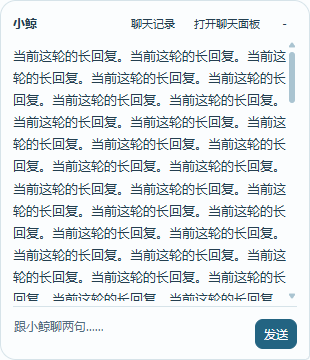
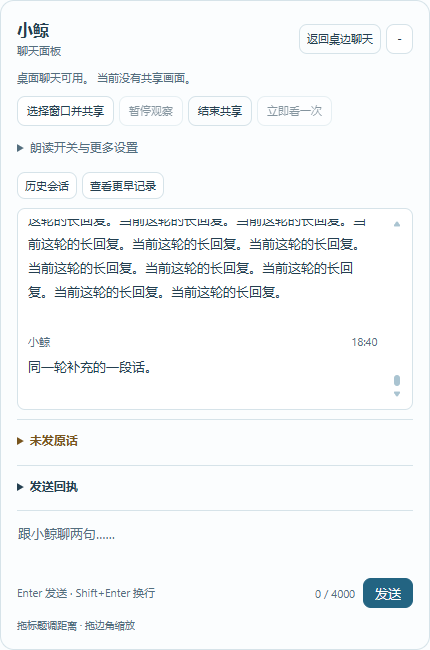
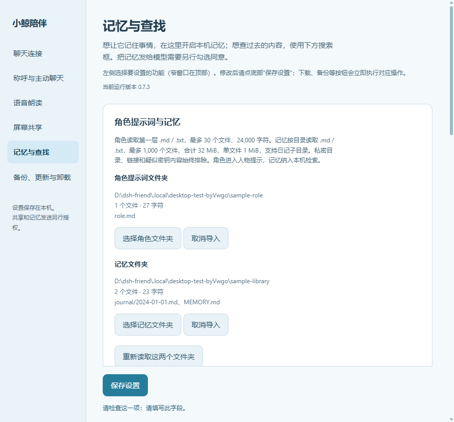

# dsh-friend · 小鲸桌面陪伴

在桌边放一个会动、能聊天的小伙伴。你可以拖动它、双击打开聊天，也可以让它看看你选中的窗口。

聊天需要你自己的 API Key，调用费用由对应服务商收取。聊天记录和设置保存在本机；屏幕共享、记忆发送都需要另外授权。

## 运行起来是什么样

下面是 Windows 下真实 Electron 界面的测试截图，内容使用隔离测试资料，不是真实用户聊天。截图中的版本和测试路径仅用于展示。

**平时主要用聊天气泡。** 双击桌宠就能展开，在气泡底部直接输入和发送；长回复可以在气泡里滚动读完。下图用长回复测试内容展示滚动效果。

| 桌面上的小鲸 | 日常聊天气泡（主要使用方式） |
| --- | --- |
|  |  |

需要翻以前的对话时，点击“聊天记录”；需要更大的窗口时，点击“打开聊天面板”。

<details>
<summary>查看展开的聊天面板</summary>



</details>

设置按用途分类，可以分别调整 API、陪伴习惯、声音、屏幕共享和记忆。



## 第一次使用，照这几步来

1. 安装 Node.js 22.12 或更新版本，并准备好 DSH（建议 0.2.0-rc.2）。
2. 按下一节的命令安装插件，启用后刷新 DSH 网页。
3. 点左侧栏底部的 **小鲸陪伴 → 打开桌宠**。
4. 在设置窗口填入自己的 API Key，点 **保存设置**。默认已填 DeepSeek 地址和模型；也能换成兼容接口。
5. 双击桌宠开始聊天。右键可打开设置、选择动作或退出。

首次启动可能需要下载 Electron，请等待面板提示；失败后可以重试。只想聊天不需要开启屏幕共享或记忆发送。

## 已经安装了，怎么升级

先结束屏幕共享，再在 **设置 → 备份、更新与卸载** 中导出一份本机备份。随后检查更新、确认安装，完成后关闭旧桌宠并重新打开，在设置里核对实际运行版本。

更新代码保留独立存放的个人资料，不会自动重启 DSH，也不会自动恢复屏幕共享。更新入口只安装通过项目 CI 的确切提交。若从 0.4 或更早版本升级后看不到网页入口，需要正常重开一次旧 Web 进程。

## 素材与署名

角色形象与 106 个动作来自 [dsh-pet](https://github.com/PC2005-cloud/dsh-pet)，保留 MIT 署名；桌面窗口与共享能力由 Electron 提供。完整第三方说明见 [THIRD_PARTY_NOTICES.md](THIRD_PARTY_NOTICES.md)。

界面素材选型与授权参考见 [美术资源说明](docs/art-direction.md)。

## 安装到 DSH

若 0.5.0 出现 `Failed to load plugins / dsh-friend: failed`，请更新到 0.5.1：该版本修正网页控制命名空间的依赖注入，并在可选控制服务不可用时保留 Web 主界面。回归测试使用真实的 Cordis 插件激活、浏览器 Remote 与插槽注册器。

需要 Node.js 22.12+，建议使用 DSH 0.2.0-rc.2。插件使用 Cordis 的 `commands`、`pluginManager`、`profileContext` 与 `typert` 服务，已附带网页模块，不需要安装时编译。

```powershell
dsh plugin --profile web add github:steady-sakura/dsh-friend
```

安装并启用后，网页左侧栏底部、设置附近会出现 **🐋 小鲸陪伴**。点开控制面板，选择 **打开桌宠**；运行后变成 **显示桌宠**。第一次会打开 设置窗口。仍可在输入框执行 **`/friend`**。

桌宠按需启动，不会随 Web 自动弹出。Web 已运行时，随时点按钮即可打开、关闭和再打开桌宠，不需要重启服务，也不需要先创建聊天会话或发送一轮模型请求。

**首次安装与升级的加载区别**：若网页未显示入口，先确认插件已启用，再刷新浏览器页面。DSH 0.2.0-rc.2 会缓存插件有没有网页模块；从 0.4 或更早版本升级时，旧 Web 进程可能仍需由本人正常重开一次，才能识别新增模块。宿主没有加载插件时，按钮无法代替插件加载；插件不会自动重启 Web。新版已加载后的日常桌宠开关无需重启。

面板还有 **设置**、**关闭桌宠**、**找到独立启动入口** 和 **卸载插件…**。关闭只保存并退出桌宠，保留资料与 Web；下次点打开可重新启动。重复点打开/显示会唤回原窗口，保留共享和草稿。面板只显示此入口启动的进程状态；独立启动的桌宠请从其右键菜单设置或退出。

按钮通过 DSH 自带的连接与 Gateway 控制六个固定操作，不另开本机 HTTP 服务，不读写 DSH 会话，不发送聊天或密钥到浏览器。通过远程浏览器连接 DSH 时，桌宠会显示在运行 DSH 的电脑上。

默认已经填好 DeepSeek API 地址和 `deepseek-flash` 模型：填入自己的 API Key，点 **保存设置**，双击桌宠就能聊。也可以修改地址和模型，使用兼容 Chat Completions 的服务。地址填写 API 根路径（例如带 `/v1` 的根地址），不要填写完整 `/chat/completions` 路径。密钥仅在本机设置窗口输入，不要发进 DSH 对话。

启动时依次检查 `DSH_FRIEND_ELECTRON`、本插件专属目录、旧 `DSH_HOME/electron`（未设置时为用户目录 `.dsh/electron`）以及本包的 npm Electron。实际运行检查版本 43.3.0 和当前架构，兼容的现成运行时只读复用，不修改 DSH 或 dsh-pet 文件。

没有兼容运行时时，先读取下载库的默认全局缓存，再读 0.7.0 的插件私有缓存；用内置的官方 SHA256 离线校验，命中有效 ZIP 不联网取校验文件。也兼容全局缓存中因旧下载来源不同而分在其他哈希子目录的同版本 ZIP，仅校验通过才复用。均未命中才下载官方 Electron 43.3.0，新内容只解压安装到插件独立目录。准备阶段（含检查、下载和解压）总限时 60 秒，窗口确认另限时 20 秒。控制面板显示阶段和下载字节进度，可点 **取消启动**；关闭请求、插件停用、独立入口 Ctrl+C 也会中止准备。失败或取消后释放忙碌状态，可重试，并提示网络、校验、解压或超时原因。网络无法访问下载源时，可设置 `DSH_FRIEND_ELECTRON` 指向兼容的现成 Electron。

## 从源码直接运行

```powershell
git clone https://github.com/steady-sakura/dsh-friend.git
cd dsh-friend
npm install
npm start
```

Windows 也可双击 `启动桌面陪伴.cmd`。安装包现在也包含该文件；在网页控制面板点 **找到独立启动入口** 可定位安装目录。之后 Web 未运行时也能双击启动，不要求先开 DSH。macOS / Linux 提供 `启动桌面陪伴.command`，可用 `sh 启动桌面陪伴.command`；有现成 DSH Electron 时，直接 `node scripts/start.mjs` 也能运行。独立运行不依赖 DSH 会话。

已经打开时再执行 `/friend`，通过父子 IPC 唤回原窗口，最小化时恢复，不冷启动另一套桌宠，也不重置共享、草稿或选择页面。启动和显示均有确认；超时不杀已有进程。桌宠入口没有固定钟点限制，不根据模型多久没回复来判断掉线。

更新后先结束使用并关闭桌宠，再正常打开。设置页显示实际加载的运行版本。不会为升级自动重启宿主；插件使用自己的 API，不连接其他项目的主程序。用户关闭桌宠不停止 DSH；宿主明确停用插件时，会关闭对应桌宠并显示本机原因提示。

## 卸载与资料保留（0.4.0 起）

0.5.0 起也可直接点网页 **小鲸陪伴 → 卸载插件…**，仍会打开相同的本机确认窗口。

从 DSH 用 `/friend` 打开桌宠，在 **API 与偏好设置 → 卸载插件…** 操作；也可在 DSH 输入 **`/friend-uninstall`** 打开同一个本机确认窗口。模型没有卸载工具，命令本身只打开确认，不直接删除。

确认窗口显示当前 DSH 配置名和实际数据目录，可选：

- **取消**：插件、共享和资料保持原状。
- **卸载并保留资料**：从当前 DSH 配置移除插件，保留聊天、日记、摘记、草稿、精选及 设置，重装后可继续使用。
- **卸载并删除资料**：移除成功后，再清理插件自己的上述资料、密钥密文、去重记录及缓存。退出桌宠后由临时清理程序释放占用并完成删除，最后显示本机结果。

先结束共享、取消 API 请求、保存草稿与排队写入并关闭素材窗口，再调用宿主的固定 `removeBundle('dsh-friend')` 接口。移除失败、结果不明或宿主断开时不启动资料清理；保存失败也不会继续移除。卸载自身时不会打断确认结果回传。卸载只移除当前配置中的安装包，不删除源码检出目录或 DSH 共用的 Electron。

**导入的角色与记忆原始文件夹保持不变**，即使原文件夹放在数据目录内也会保护。只删除具有本插件归属标记的目录中的固定资料和缓存名称；未知文件保留，不跟随符号链接或目录联接。归属无法确认、目录含项目文件时，只允许保留资料。多个 DSH 配置共用默认资料目录，选择删除会影响其他配置对这些资料的读取，确认窗口会说明。

独立源码启动的桌宠没有宿主卸载权限：先退出，再从对应 DSH 配置用 `/friend` 打开。正常 DSH 的插件管理服务负责实际移除；自定义宿主若不支持运行中卸载，会提示先停止配置，资料保留。直接使用 DSH 自带插件管理器或 CLI 移除不会经过本插件的资料询问，因此也不会自动删除本机资料。接口依据 [DSH 插件管理说明](https://github.com/deepseek-ai/deepseek-harness/tree/master/packages/boot/plugin-manager)。

## 回复正文与控制

0.6.0 默认使用 **自然正文与独立控制工具**：普通发言直接保留段落、代码和标签，动作/记忆/精选通过 `companion_control` 工具参数传递，正文里的示例不会触发操作。只支持旧 JSON 的接口可在设置的“回复方式”中手动选择 **旧 JSON 兼容模式**；不自动换模式、重试或追加一次摘要请求。两种模式都需要接口返回明确的完成状态，截断、中断、拒绝或缺少结束状态的回复仅留底。工具调用形式依据 [DeepSeek Tool Calls 文档](https://api-docs.deepseek.com/guides/tool_calls/)。

只有模型实际请求检索才续问，最多两轮；动作、摘记或定格控制本身不触发额外的模型续问，可以只做动作而不发言。旧的完整 `say/messages` 包装可兼容提取文字；自然正文模式不会执行其中的旧控制字段，代码围栏和混合说明保持原样。

## 未发原话与发送回执

展开聊天记录或打开面板，**未发原话** 单独列出已留底但明确未作为聊天发送的失败正文、检索过程文字；成功回复不会混入此列表。**发送回执** 独立记录每轮状态、时间、编号与原因，并可按编号核对对应原文。结果不明只标为“发送结果待核对”，不冒充未发送或已发送。两处分别刷新和分页，查看不触发补发。正文在解析控制参数与进入聊天记录前先留底；写盘失败会明确报错，不能声称已经保存。HTTP 错误正文、请求凭据、隐藏思考及工具参数不作为原话保存。

状态区分正在生成、已留底、正在保存聊天、正常无正文、检索过程、失败、结果待核对和本机聊天已保存。**本机聊天已保存只表示已落盘供界面显示，不代表本人已读。** 截断/中断的原话不进入正常聊天、朗读或自动日记，也不因查看回执而提交给模型。

“结束提醒”保留原文与真实状态；“核对本机记录”只按原消息编号检查会话文件，不能补发、重新生成或重做动作。退出时未确认完成的记录，下次读取按结果不明处理。新的用户消息会取消正在生成的旧回复；旧共享及过期结果不能插入新聊天。

0.7.2 起原文与回执分开存放：`reply-originals/YYYY-MM-DD/编号.json` 保存不可改写的模型原文，`deliveries/YYYY-MM-DD/编号.json` 仅保存状态等元数据，通过相同编号关联；原文目录包含各类完成状态，是否未发以回执为准。旧版合并文件继续兼容读取，不因查看批量搬移或改写。日期按电脑本地日期。两类记录默认不进 Git、记忆检索或自动日记，本机备份包含两者；卸载选择删除资料时一并清理。每次收到的可见正文最多保留 128,000 个 UTF-16 单位，超过会标记留底不完整且不作为完整回复发送。当前非流式 API 只能留住实际收到、可提取的正文，断线时不能恢复服务商尚未返回的部分。

共享窗口可以直接设置 **多久看一次**（5 秒至 2 分钟），立即保存；无需返回设置页。顶部不再显示 File / Edit 等通用菜单。

## 怎么相处

- 双击身体展开气泡聊天；气泡可切换面板。拖动标题调整距离，拖边角缩放。
- 按住身体拖动，快速松手可甩动和弹跳；轻点是互动，会单独标注，和你说的话分开。
- 右键能打开 设置、选择全部 106 个动作、共享屏幕或退出。
- 模型回复可包含文字和最多三个动作，也可以只说话、只做动作或沉默。动作只来自内置目录，没有命令执行工具。
- 默认允许每 300 秒自由活动一次；每次会调用 API，由模型自行决定是否说话。可在设置关闭或调节。
- 面板可开启本机语音朗读，默认关闭。0.7 起使用内置离线中文引擎，先在设置中下载音色并试听；可调语速、音高与音量。实际声音与窗口测试目前在 Windows 完成。

气泡只展示当前这一轮消息；同轮分成多条时用空行合在一组，最高 360 像素，长回复可在内部滚动读完。同一组新增段落时保留上翻位置；新一轮从顶部展示。之前说过的话请点 **聊天记录**，也可打开 **面板** 翻阅。面板提供共享操作、可折叠的声音与设置、历史会话和分开的原话/回执入口；输入区支持字数提示和 Enter 发送。原文仍按各条消息独立保存，同组最多触发一次短说话动画，点播动作不会被新发言打断。

## 草稿与历史会话

**历史会话** 按钮可展开或再次点击收起会话列表；选中旧会话后，可通过 **返回当前** 回到本次聊天。切换视图不重放旧话，也不调用模型。

未发送的文字和消息编号保存在本机 `preferences.json` 的 `chatDraft`。关闭、隐藏、切换面板或重新打开后恢复，不自动发送、不进日记或模型上下文。输入被本机服务确认保存后，只清空对应编号的草稿；发送过程中继续输入的新文字会保留。编号另有持久化去重记录，重开程序或记录超出当前显示范围也不会按旧编号重复调用 API。

展开气泡或打开面板后，可点 **历史会话**、**更多会话**、**查看更早记录**、**返回当前**。当前会话超过 100 条可向前分页；查看旧会话时不会被新消息覆盖，输入仍发到当前聊天，发送确认后返回当前。翻历史不会触发模型、动作、朗读或把浏览内容自动加入上下文。

新会话另存 `sessions/会话UUID.jsonl`，按 64 KiB 块从末尾读取，处理长中文、多条回复和不完整尾行；旧文件原样保留。0.2 及以前的记录以“旧版日记录”兼容浏览。历史接口只接受固定文件编号，拒绝越界路径、符号链接和目录联接，采集页面没有读取草稿或聊天历史的权限。

## 角色提示词和记忆文件夹

设置页有两个独立入口：**选择角色文件夹**、**选择记忆文件夹**。可以分别选择，也可以只选一个。

角色文件夹只读第一层 `.md` / `.txt`，按文件名排序，最多 30 个文件、24,000 字符，单文件最多 128 KiB。记忆文件夹支持日记等子目录，最多 1,000 个 `.md` / `.txt` 文件、合计 32 MiB、单文件 1 MiB、目录深度 12 层。不读取隐藏项、链接、`private` / `auth` / `state` 等敏感目录及疑似密钥文件。达到限制或略过疑似敏感内容时会提示；建议选择专用文件夹。

角色内容进入人物提示词；记忆进入本机检索库。重启时重新读取，编辑文件后点“重新读取这两个文件夹”。原文件保持只读，新增日记和摘记写入插件自己的数据目录。“取消导入”停止检索该来源，依赖该来源的长期摘记会暂停使用，原文和旧摘记不会被删除；已经存在于聊天、日记中的历史内容仍保留。路径只保存在本机 `imports.json`，不发送绝对路径。

## 日记、长期记忆和回忆旧事

默认开启本机记忆。存储与检索都是本机操作，不需要向量数据库或额外的嵌入 API。

- **日记**：完成的文字对话按本机日期写入 `memory/journal/YYYY-MM-DD.md`，原话带聊天来源编号，明确标成机械摘录。模型还可以选择留下自己的日记，另标“想法与回顾”，不当作用户事实。
- **长期记忆**：`memory/MEMORY.md` 可手动编辑。模型可从实际读过的用户原话、导入记忆或已有长期记忆中摘取原文，保存到 `memory/facts.json`。每条带出处和校验值；不接受模型自己的回复或凭空改写。用户更正可以取代旧摘记，但旧条目与原文保留。
- **分层读取**：授权后，长期内容优先、今天/昨天日记优先，近七天读摘录，再按本轮话题检索较旧来源。记忆背景约 18,000 字符预算，未展开会标明。没有现成周记/月记时直接回查日记和聊天，不捏造总结。
- **检索与回查**：默认记忆、全部旧聊天和当前导入记忆使用同一套本地关键词检索，包含中文双字匹配与相关度排序。模型可请求检索，再按不透明来源编号、字符位置和 SHA256 分页读原文；不能借此读取任意文件。单轮最多两次检索/回查续问，不在检索草稿阶段发言或播放动作。

**向 API 发送记忆需要另行授权。** 在 设置里勾选“我同意把长期记忆、日记及本机／导入记忆的检索片段发给下列 API”，核对显示的接口地址后保存。未勾选时仍能保存本机日记，并在设置页搜索和回查；模型不会收到新增记忆上下文。授权按 API 地址保存，更换地址后需重新确认。原有本轮聊天、最近对话和角色提示仍按聊天设置发送。

日记和长期摘记可随正常回复一起产生，不专门调用另一轮模型做总结；模型请求进一步检索时，可能增加最多两次原 API 调用。写入回执供下一轮读取，保存失败会在聊天状态提示，不自动重试已经完成的发言。

设置页提供“本机检索”“回查原文”“继续读取原文”“打开本机记忆目录”。检索不等于语义理解，未命中不代表事情不存在。没有导入记忆也能使用：新日记和旧聊天就是默认来源。升级前已有的聊天也纳入检索，不只限于界面恢复的最近 120 条。

## 一起看屏幕

在设置里启用图片输入。模型必须支持图片；也可给看屏幕单独配置地址、模型和 Key。文本模型无法通过本插件获得视觉能力。

点 **共享应用 / 屏幕**，选定具体窗口、勾选允许发给 API 后开始。选整屏需要额外勾选确认。只获取列表名称，不预先抓取未选窗口的缩略图；不采集麦克风、系统音或摄像头，不控制游戏。

来源选择窗由当前桌宠进程直接创建，先显示窗口再异步读来源列表；重复打开直接唤回，保留页面、选择和正在进行的共享。列表读取与共享开启分别有请求编号；撤回授权后迟到的取流会被停止，旧来源的状态、错误或结束请求不能关闭新来源。

本机约每 3 秒采样，最多保存三张内存图，长边限制在 2560×1440 范围内并保持比例，不放大低清画面。黑帧或来源没有新画面会如实提示。模型观察间隔可选 5 / 10 / 20 / 30 / 60 / 120 秒，默认 30 秒；只有实际分析才调用 API。模型忙时仍更新本机采样，不排队积压。相同内容成功分析后不重复调用，模型选择安静也算完成。

没有发生本机副作用的失败，会递增退避后重试最新采样，最多等 5 分钟；可能已经保存发言或执行动作时，不盲目重做，会暂停并说明。源变更、授权撤回、新用户消息或画面过期后的旧结果不再发送。暂停 / 继续可用面板、右键或 **Ctrl+Alt+F8**；“看一眼”显式分析当前可用定格。结束共享或关闭选择窗口会停止媒体流；锁屏、休眠会暂停，不会自动恢复共享。已经发出的请求无法从服务商撤回。

普通截图不写入磁盘。想保留某张时，可在面板写下想法并点“保存当前定格”，模型看到定格后也可选择提出带编号和想法的保存请求。只取确切会话编号和 SHA 对应的内存帧，取不到就失败，不另抓一张替代。精选以 JPEG 与来源、采样时间、尺寸、想法元数据保存到 `keeps/`，与聊天、日记和记忆检索分开，不默认加入模型上下文或 Git。

模型对画面的文字描述仍会进入本机聊天。部分全屏游戏可能盖住桌宠，可使用无边框窗口模式。窗口最小化、受保护视频、系统权限限制等情况可能无法捕获；不会偷偷换成整屏。

## 聊天与隐私

默认数据目录位于系统用户目录下：

| 系统 | 目录 |
| --- | --- |
| Windows | `%APPDATA%\dsh-friend` |
| macOS | `~/Library/Application Support/dsh-friend` |
| Linux | `$XDG_CONFIG_HOME/dsh-friend`，通常为 `~/.config/dsh-friend` |

聊天与状态记录在 `chats/YYYY-MM-DD.jsonl`，分页会话在 `sessions/`；日记、长期摘记和可编辑长期记忆在 `memory/`；精选图片与想法在 `keeps/`；设置在 `settings.json`；密钥密文在 `credentials.json`；导入路径在 `imports.json`；位置、朗读偏好和草稿在 `preferences.json`；仅含消息编号的发送去重记录为 `input-receipts.jsonl`。也可用 `DSH_FRIEND_DATA_DIR` 指定独立目录，请选择仓库外的位置。

每次重开产生新的桌面会话，旧会话通过历史入口查看。聊天上下文仍可从此前最多 120 条候选记录中选取，实际发送给 API 最多 40 条 / 48,000 字符；不意味着模型每次读完整个档案。发送失败不会自动重发或恢复旧请求。备份时退出插件后复制整个数据目录，包含草稿、历史、记忆、精选与去重记录；恢复后重新打开即可，未完成请求不自动执行。系统加密的密钥换电脑或账户后通常需要重新输入。聊天和草稿为本机明文，请按自己的隐私需求保护或备份。

插件没有遥测、第三方记忆同步或自动上传 GitHub。聊天、角色提示和明确授权的画面发往你配置的 API；新增记忆片段必须经过设置页针对当前接口的明确授权。详细说明见 [PRIVACY.md](PRIVACY.md)。

## 验证

```powershell
npm test
npm run check
npm run test:desktop
npm run test:uninstall
npm run test:launcher
npm pack --dry-run
```

测试使用模拟 API，不需要真实密钥。检查脚本验证 106 个素材的 SHA256、JavaScript 语法和发布目录中的疑似隐私内容。`test:desktop` 需要桌面环境与 Electron，使用隔离资料、本机模拟 API 和自建色块窗口，验证实际 IPC 唤回、连续回复预览、草稿重载及发送竞态、历史分页不重放、角色与记忆、动画确认、共享复用、精确帧保存及暂停/结束，不采集其他应用画面。证据仅留本机 `evidence/`，不提交。Windows 桌面端已实测；macOS / Linux 的实际窗口与系统录屏授权仍需对应平台实测。

`test:uninstall` 在隔离目录用合成资料和模拟宿主移除结果验证取消、保留、删除、失败四条真实 Electron 流程；不调用用户当前配置的卸载接口，不删除用户资料。

`test:launcher` 使用真实 React、DSH Gateway 和隔离 Electron，验证按钮按需启动、重复显示复用、设置、只刷新网页、关闭及重新打开，以及准备阶段进度、并发取消、超时提示和恢复重试。无需真实会话或 API Key；GitHub Windows 桌面任务会运行此测试及卸载测试。修改 `src/client-ui.mjs` 或共享控制契约后运行 `npm run build:client`，提交生成的 `web/client.js`；单元测试会核对源文件与预编译模块一致。

API 格式及默认模型依据 [DeepSeek 官方文档](https://api-docs.deepseek.com/quick_start)；密钥保护与屏幕采集分别使用 Electron [safeStorage](https://www.electronjs.org/docs/latest/api/safe-storage)、[desktopCapturer](https://www.electronjs.org/docs/latest/api/desktop-capturer)。

## 版本更新记录

### 0.7 新功能使用

在 **设置** 中管理声音、记忆存储位置、本机备份和插件更新。桌宠形象仍为默认小鲸，此版没有增加换形象功能。

设置页采用分栏导航：连接与模型、陪伴习惯、声音、一起看屏幕、记忆与检索、资料与更新。记住上次分类；窄窗口自动改成顶部导航，保存操作保留在底部。无效字段会自动切回对应分类并聚焦。聊天记录分开发言者、时间与正文，共享页有未共享的空状态、明确的选中来源和键盘焦点；按下动效只作用于指针，减少动态效果时取消位移，键盘切换保持即时。

- **离线声音**：点击“下载离线中文音色”，从 Sherpa-ONNX 官方 GitHub 下载约 126 MiB 的 Kokoro INT8 中英模型，校验固定 SHA256 后启用。内置 8 个中文基础音色，可保存自己的名称、语速、音高和音量，点击“保存并试听”。在聊天面板勾选“本机语音朗读”才会读新回复；试听可单独使用。按“停止声音”或发送新消息可打断，不补播积压内容。每条最多朗读前 1,000 字符，文字原文完整保留；队列有上限，失败不改走云端。离线生成使用 CPU，不需要 Python、GPU 或语音 API Key。模型与下载缓存放在本机资料目录的 `voice/`，不打包进 Git 仓库。
- **可选参考音频克隆**：需自行运行 [CosyVoice 官方 FastAPI 服务](https://github.com/QwenAudio/CosyVoice/tree/main/runtime/python/fastapi)。选择声音引擎“参考音频克隆”，选 3–30 秒的 16 位 PCM WAV（16–48 kHz，最多 10 MiB），填写对应原文、服务输出采样率，勾选本机使用确认，保存并试听。插件调用 `/inference_zero_shot`，按官方接口接收单声道 PCM16LE；仅接受数值回环地址 `http://127.0.0.1:端口` 或 `http://[::1]:端口`，不跟随重定向。更换参考音频撤销原确认；内容校验防止静默替换。参考 WAV 只复制到本机 `voice/reference.wav`，不进入聊天或记忆检索。此版提供服务接入，不包含大型克隆模型和 Python 环境。
- **记忆存储位置**：“选择记忆存储文件夹…”可复制现有日记、长期记忆和摘记到空文件夹，或使用已有且有本插件归属标记的记忆目录。源目录保留，同名不同内容时停止；路径只保存在本机 `storage.json`。与只读“记忆文件夹导入”相互独立，检索、来源编号和 API 目的地授权机制不变。外部自选记忆目录在卸载时保留。目录暂不可用时明确报错，不悄悄新建另一套记忆。
- **紧凑气泡**：按回复分组，窗口最高 360 像素；正文不裁切，内部可滚动翻看当前载入的近 100 条聊天。初次显示跟随最新回复，上翻时新消息不抢滚动位置；完整会话及更早内容仍从展开聊天的历史入口分页查看。
- **暂时安静**：可暂停主动聊天和自动屏幕分析 30 分钟、1 或 2 小时，也可立即恢复。手动聊天、“看一眼”仍可使用；到期继续原来的活动频率。
- **接口工具能力**：用已保存的接口发一次小型工具测试，不带历史、记忆、画面或动作。显示是否收到正确工具调用，失败不自动切换模式、不重复原聊天请求；有少量接口额度消耗。
- **本机备份**：导出 `.dshbackup`，包括聊天、回复留底、当前自选记忆、设置、密钥密文和参考音频。导入原文、精选截图、浏览器缓存及语音模型不包含；完整搬家可另外复制整个数据目录和自选记忆目录。备份含私人资料且不额外加密，请自行妥善保管，不上传仓库。恢复会先在资料目录 `backups/` 保存当前副本，再写回同名文件；不删除备份中没有的文件。路径、内容校验和大小限制不通过就停止；中途失败时保留恢复前副本。恢复后关闭桌宠重新打开。系统密钥加密通常不能跨设备迁移，需重填 API Key。
- **用户自行更新**：从 DSH 打开桌宠，进入设置点“检查更新”，查看官方仓库 README，再确认安装。仅安装 `steady-sakura/dsh-friend` 的 main 分支已通过“Check plugin”CI 的固定提交，不自动更新；相同版本修正也可手动重装。安装走宿主 `pluginManager.installBundle`，正常包管理失败由宿主恢复配置及锁文件；结果不明不报告成功或自动重试。资料保持独立。结束共享后安装，完成后关闭旧桌宠从 DSH 重新打开；只有宿主要求时才由使用者正常重启 Web。独立入口需要退出后从 DSH 打开更新。

0.7.3 起，安装期间显示阶段与等待时间，暂停接话但允许查看记录、切换聊天视图和调整气泡。明确安装失败后恢复当前桌宠使用；结果不明则提示先到 DSH 插件管理器核对，再重新打开，不自动重试。安装完成后的确认窗口不再占用维护状态；旧桌宠会说明自己仍运行旧版本，并停止写入偏好，避免覆盖新版资料。

聊天记录使用白色内容区，未发原话和发送回执使用浅蓝内容区，均有固定内边距与独立滚动边界；折叠标题位于内容滚动区之外，避免滚动文字贴到相邻标题。插件通过包管理器链接安装时，也会正确识别 Electron 准备进程的实际入口，不要求另外安装 dsh-pet。

0.7 起新下载的 Electron 固定版本安装在 `DSH_HOME/dsh-friend-runtime/electron-43.3.0`（未设置 DSH_HOME 时为用户目录 `.dsh/dsh-friend-runtime/electron-43.3.0`）。0.7.1 恢复兼容旧运行时的只读回退，并优先读取默认全局缓存；下载和解压临时文件只写插件独立目录，校验成功后才安装。取消或失败的临时目录可能保留，不自动删除旧内容。动画、物理代码及动作目录已随本插件独立打包；不依赖 dsh-pet 安装，也不修改旧的 `.dsh/electron`。显式 `DSH_FRIEND_ELECTRON` 是高级用户/测试的自选覆盖。旧共用运行时不会自动删除。

声音来源：[Sherpa-ONNX](https://github.com/k2-fsa/sherpa-onnx)、[Kokoro](https://huggingface.co/hexgrad/Kokoro-82M)。署名和许可见 `THIRD_PARTY_NOTICES.md`。可选克隆本轮只验证接口协议，未以真实 CosyVoice 大模型验证音质和延迟；内置 Kokoro 中文合成已在 Windows 实测。

### 各版本更新

版本号以插件自己的 `package.json` 为准；设置页显示实际加载的桌宠版本。更新代码不会让已运行的旧桌宠自动加载，也不会自动恢复屏幕授权或重启 DSH。更新前结束共享并关闭桌宠，正常重新打开后核对版本；个人数据目录保持独立。

| 版本 | 更新内容 |
| --- | --- |
| **0.7.4** | 移除默认窗口菜单，按用途命名设置分类并补充操作步骤；共享窗口可直接保存观察间隔。整理设置布局与聊天样式，修复减少动态效果下按钮缩放，加入真实界面截图和入门说明。资料格式不变。 |
| **0.7.3** | 修复包链接安装时 Electron 准备进程误判入口而直接退出。更新维护状态增加可读提示与等待时间，保留记录查看和界面调整；安装完成后先释放维护状态再显示确认，明确失败恢复使用，结果不明要求核对，旧桌宠冻结偏好写入。聊天记录、未发原话和回执使用明确底色、固定内边距与独立滚动边界，标题不再混入滚动内容。新增包链接启动和真实更新状态回归验证。 |
| **0.7.2** | 参考聊天原型精简气泡与面板，提供更清楚的输入区、字数提示与可折叠声音设置。历史会话按钮可再次收起；气泡仅显示当前回复组，长回复内部滚动，之前内容通过聊天记录查看。未发原话与发送回执分开显示、独立分页，未知结果明确待核对；模型原文与回执元数据分目录存储，兼容旧记录，备份与卸载同步覆盖。 |
| **0.7.1** | 修复 0.7.0 启动永久忙碌：恢复旧 Electron 路径的版本与架构验证、只读复用；优先使用默认全局缓存及固定官方 SHA256，缓存可离线校验。准备阶段增加 60 秒总超时、可终止子进程、阶段与字节进度、取消启动按钮及可归因错误，关闭/停用可中止准备，失败后可重试。补充真实网页取消、超时和恢复测试。 |
| **0.7.0** | 分栏设置导航、聊天发言者与时间层级、共享空状态与来源选择反馈；窄屏、长内容、键盘焦点与减少动态效果支持。修复动作编号混入正文，保留原始回执且不执行正文尾部编号；紧凑气泡限高并支持滚动，保留上翻位置。独立 Electron 运行时与下载缓存；自选记忆目录、复制迁移、离线可恢复设置入口和外部目录卸载保护。新增本机 Kokoro 中文音色、调音试听及可选本机 CosyVoice 参考音频克隆；加入暂时安静、工具能力测试、本机备份恢复，以及固定官方 CI 提交的用户确认更新入口。此版运行时迁移存在旧路径与缓存回退缺失、准备阶段无超时的回归，建议使用 0.7.1 或更新版。 |
| **0.6.0** | 普通正文与原生控制工具分离；保留手动旧 JSON 兼容模式。检查生成结束状态，截断、中断及缺少状态的文字只留底；坏控制参数不吞正常正文。新增“未发原话与回执”、分页原文、结束提醒及按消息编号核对本机记录；区分安静、失败、结果不明和本机已保存，防止查看触发重放。收到新输入取消旧生成，索引异常可降级为普通聊天；新增留底随备份并纳入可选卸载清理。 |
| **0.5.1** | 修复 0.5.0 网页模块读取 `remote.friendLauncher` 时缺少依赖注入导致 Web boot 失败的问题；改为挂载后通过子作用域注入。可选控制服务失败时保留 Web 主界面，新增真实 Cordis、浏览器 Remote 和插槽注册器的激活回归测试。 |
| **0.5.0** | 增加 DSH 侧栏“小鲸陪伴”按钮：按需打开/显示、设置、关闭、卸载和定位独立启动文件；不用创建模型会话。独立启动脚本纳入安装包，网页刷新不重建桌宠，增加 Windows 按钮/卸载集成 CI。此版本存在上列网页激活缺陷，应使用 0.5.1 或更新版本。 |
| **0.4.0** | 增加卸载确认窗口及 `/friend-uninstall`。可选择保留资料，或在宿主确认移除成功后清理本插件数据；保护原始导入文件夹与未知文件，不跟随链接；关闭进程后处理文件占用并显示清理结果。 |
| **0.3.0** | 持久草稿及发送竞态保护、跨重启输入去重、当前/历史会话分页、连续多条回复气泡、原窗口 IPC 唤回、拖甩坐标安全；共享请求代次隔离、采样与观察分离、三帧内存缓存、精确定格收藏及观察失败退避。 |
| **0.2.0** | 本机日记、带出处的长期摘记、递归导入记忆、中文关键词检索及原文分页回查；长期/近期/话题分层载入。新增默认关闭、按 API 地址确认的记忆发送授权，接口变化需重新同意。 |
| **0.1.1** | 修复 macOS `/var`、`/tmp` 解析到系统 `/private` 容器后被误判为私人目录的问题；仍禁止用户自己的 private 目录及不安全链接。 |
| **0.1.0** | 首版独立 DSH 桌面陪伴：dsh-pet 形象与 106 个动作、自填兼容 API、模型自主发言与选动作、明确授权的应用/屏幕共享、本机聊天与密钥保护，以及角色提示词/记忆文件夹读取。 |
